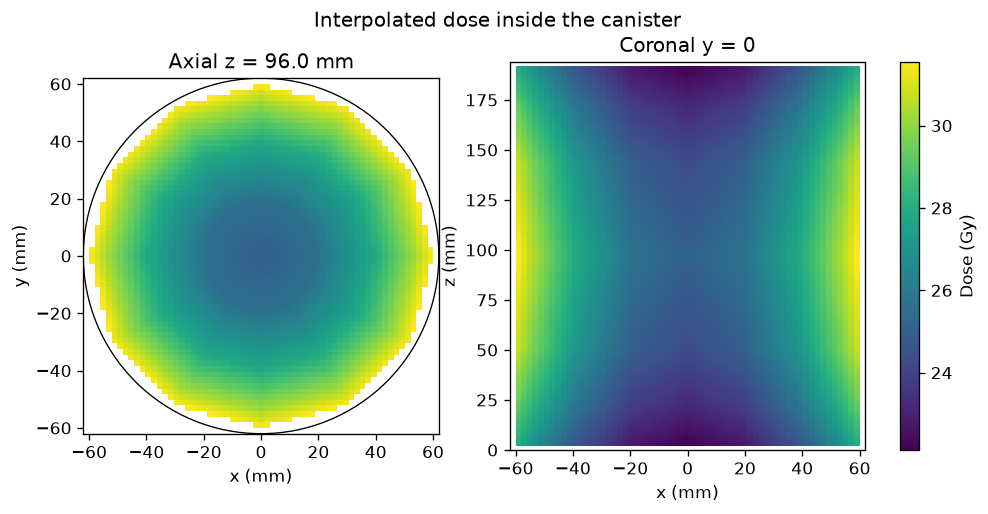
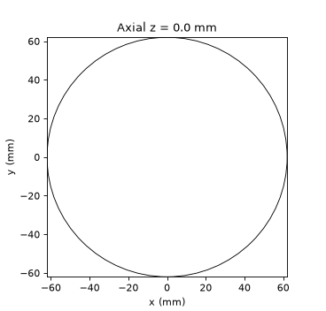

# Dose 3D canister

Reconstruct a three-dimensional dose map inside a blood-irradiator canister
from discrete dosimeter points (TLD, OSL or film samples).

The default volume is the **Gammacell 3000 Elan** canister published by Best
Theratronics: internal diameter 124 mm, internal height 194 mm, volume 2.34 L.
The canister turns between fixed Cs-137 sources. A typical vendor map with
25 Gy at the centre is about 19 Gy minimum and 33 Gy maximum.

This package does not run a Monte Carlo transport. It interpolates the points
you give it, reports the usual blood-irradiation comparisons, and scales the
irradiation timer for Cs-137 decay between mappings.

## What it will not tell you

Linear interpolation inside the convex hull of the samples cannot see a hot
or cold spot that sits between the dosimeters. Nodes outside that hull are
left empty. The coverage fraction, the distance to the nearest sample and the
indicative uncertainty are there so a smooth picture is not mistaken for a
measurement.

The indicative uncertainty combines the input standard deviation with a term
that grows when neighbouring samples disagree and the node is far from them.
It is a display model, not a GUM uncertainty budget.

Do not use the output as a clinical release decision. The synthetic generator
is an illustration: the centre is fixed at 25 Gy, the wall is higher and the
ends are lower. It is not a measured map and not a transport result.

## Criteria

| Preset | Command | Bounds |
| --- | --- | --- |
| FDA/AABB | `--criteria fda-aabb` (default) | ≥ 25 Gy at the centre, ≥ 15 Gy in the volume |
| Portaria MS 158/2016 | `--criteria portaria158` | 15 Gy to 50 Gy, central-plane mean ≥ 25 Gy |
| BCSH | `--criteria bcsh` | 25 Gy to 50 Gy |

`run` exits with status 2 when a configured bound fails.

## Install

```bash
pip install -e ".[dev]"
```

Python 3.11 or newer.

## Commands

```bash
dose3d-canister synthetic -o examples/synthetic_gammacell.csv
dose3d-canister run examples/synthetic_gammacell.csv -o out
dose3d-canister correct-time --previous-seconds 336 --previous-date 2026-01-15 --date 2026-10-27
```

`run` writes `metrics.json`, `dose3d.html` (slices and isodose surfaces),
`slices.png` and `report.pdf`. Pass `--history mappings.json --date YYYY-MM-DD
--irradiation-time-s 336` to append that mapping.

The Cs-137 half-life used for the timer is 30.08 years. One half-life later
the same dose needs twice the irradiation time.

The committed synthetic map pins the centre at 25 Gy. On that illustration
the wall reaches about 32 Gy and the ends of the axis stay near 22 Gy, so
the FDA/AABB preset passes. About 9% of the canister nodes stay empty
because they lie outside the convex hull of the samples.





CSV columns: `x_mm`, `y_mm`, `z_mm`, `dose_gy`, and optional `uncertainty_gy`.
The origin is on the canister axis and `z = 0` is the bottom.

## Library

```python
from dose3d_canister.criteria import FDA_AABB
from dose3d_canister.geometry import GAMMACELL_3000_ELAN
from dose3d_canister.interpolate import reconstruct
from dose3d_canister.io import read_points
from dose3d_canister.metrics import summarise

points = read_points("examples/synthetic_gammacell.csv")
volume = reconstruct(points, GAMMACELL_3000_ELAN, spacing_mm=2.0)
metrics = summarise(points, volume, GAMMACELL_3000_ELAN, FDA_AABB)
```

PyVista is an optional extra (`pip install -e ".[pyvista]"`).
`dose3d_canister.view.pyvista_cloud` builds a point cloud from the
reconstructed nodes.

## Development

```bash
pytest
```

## References

- Best Theratronics, Gammacell 1000 Elite / 3000 Elan brochure: internal canister 124 mm by 194 mm, 2.34 L, typical uniformity about 19 / 25 / 33 Gy.
- FDA, *Recommendations regarding license amendments and procedures for gamma irradiation of blood products* (1993): 25 Gy at the centre of the canister and a minimum of 15 Gy.
- Brazilian Ministry of Health, Portaria nº 158/2016: minimum 15 Gy, maximum 50 Gy, central-plane mean at least 25 Gy.
- Chapman et al., BCSH guidelines on gamma irradiation of blood components, *Transfusion Medicine* 6 (1996): minimum 25 Gy, maximum 50 Gy.

## License

MIT.
